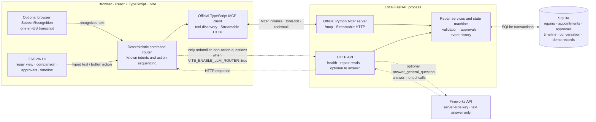

# FixFlow

**A repair should not become the homeowner’s problem again just because the first appointment failed.**

FixFlow is a voice- and text-enabled household repair prototype built around **persistent resolution**. It remembers the appliance and repair history, compares simulated repair partners against household constraints, requires explicit approval before booking, and keeps the case open through a missed visit, a follow-up, and the homeowner’s final confirmation.

> **Hackathon demo, not a live service.** FixFlow is a local web app inspired by a conversational household assistant. It is not an official Alexa+ product, does not run on Alexa hardware, and does not contact real contractors, calendars, warranty providers, or payment services. Repair partners, availability, estimates, warranty records, calendar conflicts, and visit outcomes are seeded simulations.

**For judges:** [Jump to the reproducible demo](#judge-demo) · [See the architecture](#architecture) · [Read the Ring Developer Playground friction log](FRICTION_LOG.md)

## The product idea

Most repair directories stop at “here are some contractors.” A basic chatbot may stop at “here is some advice.” FixFlow models the longer, messier job a household actually needs done: **keep a repair moving until someone confirms it is fixed**.

The current seeded story is a recurring washing-machine leak. FixFlow has a prior hose-repair record and a simulated warranty on file; it can compare partners using the demo budget, simulated brand-authorization preference, household calendar, reliability, and past jobs. If the repair partner misses the visit, the homeowner can record the no-show, see compatible alternatives, review a new proposal, and explicitly approve it. A simulated completion is not treated as success: the case waits for the homeowner to say whether the leak stopped.

The differentiator is the **persistent, auditable workflow**—repair state, appointment history, approval, timeline, and conversation are saved together—not a claim that the prototype has live dispatch or real-world integrations.

## The experience

### A household repair that stays in view

The overview keeps the active incident, current next step, conversation, warranty context, and repair history connected. Navigating away or reloading the app does not turn the repair into a fresh conversation.


### Talk or type

The conversation panel supports ordinary text input and an optional microphone button. When clicked, FixFlow uses the browser’s `SpeechRecognition` or `webkitSpeechRecognition` API if available. It requests one final English (`en-US`) transcript, then submits the recognized phrase as the same text command used by the chat box. The browser may request microphone permission. Voice recognition support and its underlying speech service depend on the browser and platform; if the API is unavailable or recognition fails, FixFlow gives a message and typing remains available.

This is **speech-to-text input, not a voice assistant audio pipeline**: FixFlow does not implement audio recording, does not save audio files, and does not speak replies aloud. Recognized commands go through the ordinary command router and repair tools. A recognized phrase is submitted immediately rather than presented for confirmation first. Voice is optional; all demo actions can be performed by typing or using the UI.

The conversation screenshot shows the text conversation experience; it is not evidence of a particular browser’s microphone recognition service.


### Compare with constraints

The seeded partner list makes trade-offs visible instead of presenting a contractor directory as if its data were live. The default budget is **$250 all-in** and the simulated brand-authorized-only filter is on:

| Simulated repair partner | Repair estimate | Visit fee | All-in estimate | Demo constraint |
|---|---:|---:|---:|---|
| BrightFix Appliance Care | $220 | $25 | **$245** | Marked authorized in demo data |
| RapidHome Repairs | $325 | $35 | **$360** | Over the default budget |
| Northstar Appliance Service | $180 | $30 | **$210** | Not marked authorized in demo data |

These are fictional seed values, not quotes, verified credentials, warranty coverage decisions, or manufacturer certifications. The backend rechecks the chosen budget, authorization preference, slot ownership/availability, and simulated calendar before it saves a proposal.


### Approval before a booking

Selecting a time creates a persisted proposal and a repair-scoped approval ID; **it does not book the visit**. The homeowner can review the partner, time, and estimate, then approve or reject that exact proposal. The backend independently verifies the approval and appointment before committing a simulated booking. Replacing a visit retains the previous appointment in history.

No payment is taken or authorized by this prototype. The approval gate controls the simulated booking workflow, not a financial transaction.


### Recover, follow through, confirm

The prepared scenario starts with a simulated BrightFix visit already booked. The homeowner can record a simulated no-show; FixFlow keeps the repair open and finds calendar-compatible simulated alternatives. After a replacement is approved and booked, the visit-completed control records a **simulated** technician outcome and moves the case to “Awaiting your confirmation.” If the homeowner says the leak remains, the case returns to in-progress; if they confirm it is fixed, it becomes resolved. Closing is a separate explicit action, and history is retained.

This is workflow simulation, not a real provider response or a technician’s report from an actual visit.


## Judge demo

### Start the app

Requirements: Python 3.10 or newer, Node.js with npm, and a browser. No API key or external service is required for the core demo.

From the project root, create a virtual environment, install the backend dependencies, reset the local SQLite demo data, and start FastAPI:

```bash
python3 -m venv .venv
source .venv/bin/activate
python -m pip install -r requirements.txt
python -m backend.app.seed --reset
uvicorn backend.app.main:app --reload --host 127.0.0.1 --port 8000
```

In a second terminal:

```bash
cd frontend
npm install
npm run dev
```

Open **http://127.0.0.1:5173**. FastAPI initializes the schema and seeds a demo household on first startup if the database is empty. `python -m backend.app.seed --reset` replaces the local demo records, so use it only when you want to restart the scenario.

### Reproduce the repair-recovery story

1. **Start from the seeded case.** The active washing-machine repair has a booked BrightFix appointment, an earlier repair record, a simulated active warranty, a work-call calendar conflict, and three fictional repair partners.
2. **Try voice or text.** Click the microphone and say **“Repair partner missed visit”** if browser speech recognition is available; otherwise type the same command. The seeded event is explicitly simulated—no provider is contacted.
3. **Review alternatives.** FixFlow records the no-show against the current booked appointment and shows available, calendar-compatible slots with budget and authorization exclusions. Select an eligible option and choose its displayed time. This creates a proposal, not a booking.
4. **Approve the exact proposal.** Review the approval card and click **Approve & book**. The browser calls the approval tool and then the booking tool with the saved approval ID. The repair and appointment are refreshed from the backend.
5. **Demonstrate resolution, not just scheduling.** Click **Simulate Visit Completed**, then choose **Still leaking** or **Yes, it’s fixed**. A simulated completion alone does not resolve the case; confirmation is a separate decision. Closing a resolved repair is separate again.

Seeded appointment dates are generated relative to the time the database is reset, so use the time shown in the UI rather than expecting a fixed calendar date. The UI also supports selecting a partner and available time directly from the comparison and appointment cards.

## Architecture

The browser orchestrates user requests and uses MCP for the repair workflow. FastAPI hosts both the MCP endpoint and a small set of HTTP endpoints. SQLite is the durable source of truth. Fireworks is a separate, optional path for general conversational questions; it does not receive repair tools or execute actions.



The microphone uses the browser-provided speech recognition API; speech-recognition processing is browser/platform dependent and is not implemented by the FixFlow backend. Core repair reads and mutations use MCP, not a sequence of UI-only mock responses. The optional Fireworks path is separate: known repair commands and action-like commands stay in deterministic routing; Fireworks can answer unfamiliar conversational questions when enabled, but it cannot approve, book, reject, complete, resolve, or close a repair.

### Why MCP matters here

FixFlow uses the official TypeScript MCP client and Python MCP server over **Streamable HTTP** at `/mcp`. The client performs MCP initialization and tool discovery, then calls named tools such as `get_repair`, `find_alternatives`, `prepare_proposal`, `approve_action`, `book_appointment`, and `confirm_resolution`. The server delegates these calls to the same repair services that enforce the workflow and persist changes in SQLite. This keeps the UI’s interaction model separate from server-side state validation; MCP is the actual tool boundary, not a label for an internal function call.

FastAPI also exposes `/api/health`, repair-read endpoints, and the optional `/api/agent/interpret` and `/api/agent/status` endpoints. The browser uses `/api/agent/interpret` only for the optional conversational-answer path; the ordinary repair workflow is carried over MCP.

## What is implemented—and what is not

| Capability | Implemented in this prototype | Boundary |
|---|---|---|
| Persistent repair case, appointments, approvals, timeline, and conversation | SQLite schema, services, and MCP tools | Local database; no hosted account or sync |
| Repair partner comparison and budget/authorization preferences | Seeded partner data, UI filters, and backend proposal validation | Fictional values; authorization flags are not independently verified |
| Calendar-aware appointment selection | Seeded household calendar blocks and server-side conflict checks | Not connected to Google, Alexa, or another live calendar |
| Approval-gated appointment booking | Exact repair-scoped approval ID is checked before a simulated booking | No vendor dispatch and no payment processing |
| No-show recovery and replacement appointments | Simulated no-show, alternative discovery, proposal, approval, and booking | Does not receive a real provider event |
| Visit outcome and household resolution confirmation | Simulated completion followed by explicit user confirmation and optional closure | No actual technician report or appliance sensor |
| Voice input | Browser Web Speech Recognition where supported | Browser-dependent speech-to-text; no wake word, Alexa hardware, audio storage, or spoken replies |
| Optional conversational AI | Backend Fireworks API answer for unfamiliar, non-action questions when enabled | Requires user-supplied server-side key; not used for repair actions |

## Ring Developer Playground feedback

The Ring Developer Playground friction log documents a **separate development experience** during the hackathon. It is not a FixFlow feature, and FixFlow does not integrate with Ring. The log explains what worked, where fixed simulated streams limited controllable event testing, and the improvement suggested:

**[Read the Ring Developer Playground friction log](FRICTION_LOG.md)**

## Run the tests

Backend tests cover the workflow state machine, SQLite/database behavior, vendor selection, MCP tools, and the MCP HTTP protocol:

```bash
source .venv/bin/activate
pytest -q backend/tests
```

Frontend tests and production build:

```bash
cd frontend
npm test
npm run build
```

With both development servers running, the repository also includes an end-to-end local smoke script:

```bash
bash scripts/smoke_local.sh
```

## Optional Fireworks setup

The seeded workflow works without Fireworks. To enable conversational answers for unfamiliar questions:

1. Copy the root `.env.example` to `.env` and set `FIREWORKS_API_KEY`.
2. Copy `frontend/.env.example` to `frontend/.env.local` and set `VITE_ENABLE_LLM_ROUTER=true`.
3. Restart the backend and Vite development server.

The key stays in the backend environment; never put it in a `VITE_*` variable. Known actions such as approval and booking remain deterministic and use MCP with server-side checks whether or not Fireworks is configured.

## Project map

- `frontend/src/App.tsx` — application layout, data loading, approval and booking UI flows
- `frontend/src/components/ConversationPanel.tsx` — typed conversation and optional browser speech recognition
- `frontend/src/lib/agent.ts` — deterministic command routing and explicit MCP tool sequences
- `frontend/src/lib/mcp.ts` — official browser-side MCP client
- `backend/app/main.py` — FastAPI app, lifecycle, REST endpoints, and MCP mounting
- `backend/app/mcp_server.py` — Python MCP tool definitions and server-side error boundary
- `backend/app/services.py` — repair operations, validation, approvals, and persistence
- `backend/app/state_machine.py` — allowed incident transitions
- `backend/app/database.py` — SQLite schema, migrations, and connection handling
- `backend/app/seed.py` — resettable household, repair, partner, appointment, and calendar demo data
